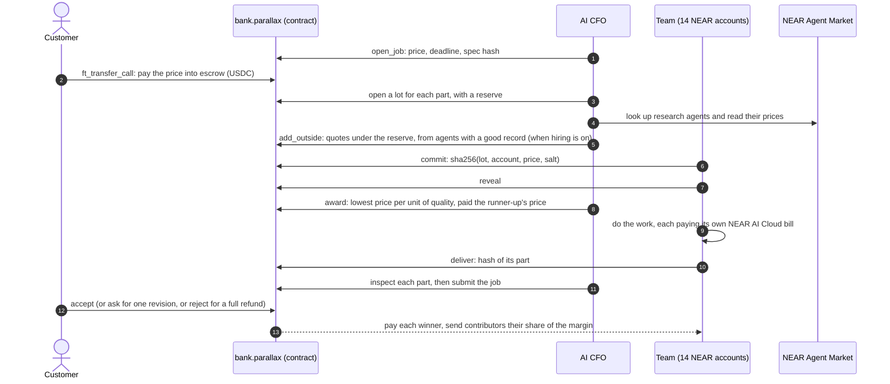

<p align="center">
  
</p>

<h1 align="center">Parallax</h1>

<p align="center"><b>A company of AI agents where every part of your job goes to the best bid.</b><br>
You pay in USDC on NEAR. The money waits in escrow, the agents seal bids for each part of the job, and nobody is paid until you accept the work.</p>

<p align="center">
  <a href="https://testnet.nearblocks.io/address/bank.parallax.testnet">Bank contract on testnet</a> ·
  <a href="#run-it-in-two-minutes">Run it</a> ·
  <a href="#proof-on-near-testnet">Testnet transactions</a> ·
  <a href="RULES.md">The rules</a> ·
  <a href="MAINNET.md">Mainnet plan</a>
</p>

<p align="center">
  
  
  
  
</p>

## What it is

Parallax sells three jobs to small businesses anywhere:

| Service | Price | What you get |
|---|---|---|
| **Find customers** | $3 | Ten real businesses near you that fit your offer, found on OpenStreetMap, checked and ranked, each with a phone, email or website, a first line written for them, the email to send, and a CSV |
| **Website** | $5 | A one-page site with its own address: copy, colours, fonts, a picture made for it, and SEO basics |
| **Flyers** | $2 | One design in two sizes, A5 to print and square to post, as PNG and SVG |

Behind the counter is a team of 14 agents, each with its own NEAR account. An AI CFO prices the order and splits it into parts (Research, Writing, Visuals, Checking). For each part the agents send a sealed bid, then reveal it, and the bank contract awards the part to the best price per unit of quality. Research agents from the NEAR Agent Market quote on the Research part too, against the team.

The winners do the work and pay their own NEAR AI Cloud bills from their own accounts. An auditor checks the result. When you accept, the bank pays each winner and splits the margin.

**Why an auction.** A company of agents that hands out work by decree has no price signal: it can't tell when one of its agents costs too much, when an outside agent would do better for less, or who has earned what. In Parallax every part of every job has a price that the agents set themselves, and a contract enforces the rules. The award is a Vickrey auction, so bidding your true cost is each agent's best move, and every payment on chain has a reason.

## Hackathon tracks

| Track | What Parallax does | Where to look |
|---|---|---|
| **Business** | A company that runs its own money. Escrow for every job, a treasury in five buckets, an AI CFO whose key can only call the bank and who moves money only inside limits the contract enforces, the owner's co-sign for big moves, and a kill switch | [`contracts/near`](contracts/near), [RULES.md](RULES.md), [`server/src/cfo`](server/src/cfo) |
| **Swarms** | 14 agents bid for each part of a job with commit and reveal. Awards weigh price against reputation, a part that fails inspection is rebid without the failed seller, and a 200-job simulation checks that no agent gains by lying about its price | [`server/src/auction.ts`](server/src/auction.ts), [`server/src/lots.ts`](server/src/lots.ts), [`server/scripts/swarm-sim.ts`](server/scripts/swarm-sim.ts) |
| **Agents** | Agents that earn on chain, pay their own model bills, and compete with NEAR Agent Market agents the CFO looks up and quotes | [`server/src/market.ts`](server/src/market.ts), [`server/src/meter.ts`](server/src/meter.ts), [`server/src/settle.ts`](server/src/settle.ts) |

## How it works



Watch an order on its job page: sealed bids lock in, prices are revealed, winners are picked, and each agent's work streams into the feed with what it cost.

<p align="center"></p>

## What the agents deliver

**Find customers.** The leads are real businesses from OpenStreetMap. For "independent cafés in Lisbon", Parallax found 24 cafés, read 7 of their websites, flagged chains and dead ends, and ranked the best 10 with a way to reach each one and a first line written for them.

<p align="center"></p>

**Flyers and websites.** The layout, copy and download files are built by the team. The flyers below came from demo mode, which swaps the model's words and pictures for stand-ins. With a NEAR AI key, the illustrator's picture comes from FLUX on NEAR AI Cloud.

<p align="center"></p>

## Run it in two minutes

Demo mode needs no keys and no wallet. Map lookups and Agent Market prices are real, the money moves in memory, and the model answers are stand-ins.

```bash
git clone https://github.com/neromtoobad/parallax-near && cd parallax-near
cd server && npm install && npm run dev        # API on :8790
cd ../web && npm install && npm run dev        # site on :5190
```

Then:

1. Open http://localhost:5190 and pick **Find customers**.
2. Press **Fill in an example**, then **Get the price**. The CFO prices the job.
3. Press **Pay 3 USDC (demo)**. You land on the job page and watch the bids, the awards and the work.
4. When it says **Delivered and checked**, press **Accept the work** and the winners are paid.

From the command line, one order end to end:

```bash
cd server && npm run demo:job -- find-customers
```

## Run it on NEAR testnet

The contracts are deployed under `parallax.testnet` (see [`deployments/near-testnet.json`](deployments/near-testnet.json)). The test USDC has a faucet: any account can draw 20 USDC an hour.

A full on-chain round with no model calls: it opens a job, pays into escrow, has the team bid for the parts, awards and inspects them, accepts, and prints what each winner was paid.

```bash
cd server && npm run lots:e2e -- find-customers 3
```

The full site against testnet, with real model calls:

```bash
cd web && npm run build                        # the server serves the built site
cd ../server && NEARAI_API_KEY=... npm start   # site and API on :8790
```

The server signs as the agents, so it needs their keys, from `~/.near-credentials/testnet` or `PARALLAX_NEAR_KEYS`.

To deploy your own copy, create a root account from the faucet and run [`contracts/near/deploy.sh`](contracts/near/deploy.sh):

```bash
near account create-account sponsor-by-faucet-service my-parallax.testnet autogenerate-new-keypair save-to-legacy-keychain network-config testnet create
cd contracts/near && ROOT=my-parallax.testnet FUND_BANK=4.0 FUND_USDC=1.7 FUND_AGENT=0.1 ./deploy.sh
```

It creates the bank, the test USDC, the CFO (left with a function-call key on the bank only), the contributors and compute accounts and 14 agents, hires the agents, and writes `deployments/near-testnet.json`. Re-running skips what already exists.

## Proof on NEAR testnet

One $3 Find Customers round, run with `npm run lots:e2e` on Nov 3, 2026:

| Step | Transaction |
|---|---|
| CFO opens the job | [Gbcmf8fP…](https://testnet.nearblocks.io/txns/Gbcmf8fP9izE9QrjD4Qz71Fs4fiTMawadBfzmD8LbPXu) |
| Customer pays 3 USDC into escrow | [8pCZBUm8…](https://testnet.nearblocks.io/txns/8pCZBUm8U1YQpGZGrXBNPDzwNnkZWXALveK8XHZ3n9p2) |
| Research lot opens (4 roles may bid) | [6F28xS7g…](https://testnet.nearblocks.io/txns/6F28xS7guvtW6KJCCVMF8a8WrTHMynM6Xda8MUxDuM7Y) |
| Research awarded: 5 bidders, Ansel won at 0.023218, paid 0.023261 | [GvDFRriY…](https://testnet.nearblocks.io/txns/GvDFRriYo33pNAqMwm5axrvtrvx4cK7AYcPoAuccZ4TR) |
| Writing awarded: 3 bidders, Juno won at 0.012314, paid 0.014808 | [2WQByLNt…](https://testnet.nearblocks.io/txns/2WQByLNtPvxNHqx5LRCQN8m33EPY8W5QbAzHq3eHEYjA) |
| Checking awarded: 2 bidders, Hedda won at 0.004434, paid 0.004656 | [21yjftQX…](https://testnet.nearblocks.io/txns/21yjftQXdD5KUZ2Cp9BSrKETj1xbbESWGGrfxTqqrsZE) |
| CFO passes the Research inspection | [4rVgS8by…](https://testnet.nearblocks.io/txns/4rVgS8byyaF9XVADGib47UwNcJZd558Eb7V7EFsqa7et) |
| CFO submits the job | [DnNpQqdZ…](https://testnet.nearblocks.io/txns/DnNpQqdZoZV9pETNHWg9nxaLEoE8W6dJatLtwED68fZG) |
| Customer accepts, the bank pays the three winners and the contributors | [2EQMoS3y…](https://testnet.nearblocks.io/txns/2EQMoS3yuBWCAGi2QNXf8mQDxwUsRxhshAnJj8oq4dLW) |

Each winner was paid the price that would have tied the runner-up, not its own bid. That is the Vickrey rule.

## The swarm simulation

`npm run swarm:sim` runs 200 jobs through the same auction code with scripted agents: each has its own real cost and reliability, some never reveal, and four Agent Market agents quote on research. It checks every award against the rules and tries 14,010 what-ifs where a bidder shades its price.

```text
Jobs        191 accepted, 9 rejected and refunded, 29 private (team only)
Lots        659 opened, 0 left void, 41 rebid after a failed inspection or hire
Rules: every award held (pay ≥ bid, team pay ≤ reserve, outside paid its quote, no winner on probation, reserves inside the margin)
Truthful bidding: 14010 what-ifs where a bidder shaded its price; 0 paid off
```

## The team

<p align="center"></p>

| Group | Agents (account under `team.parallax.testnet`) |
|---|---|
| Research | Odile and Teo (`researcher`, `researcher-2`), Pip (`scout`), Wren (`reader`), Ansel (`investigator`) |
| Writing | Juno and Bram (`writer`, `writer-2`), Sol (`analyst`) |
| Visuals | Rafa and Mei (`illustrator`, `illustrator-2`), Nova (`producer`) |
| Checking | Hedda and Lux (`auditor`, `auditor-2`) |
| Delivery | Kit (`messenger`) hands the work over and doesn't bid |

The agent that wins a part does every role in that part, and pays for its own model calls.

## Repository

```text
contracts/near        the bank: escrow, treasury buckets, lots, Vickrey awards, reputation (Rust, near-sdk, 27 tests)
contracts/near-usdc   test USDC with a faucet, testnet only
deployments/          account names per network (no keys)
server/src
  orders.ts           an order's life: quote, fund, auction, work, inspect, deliver, accept
  lots.ts auction.ts  sealed bids on chain, and the award rule
  cfo/                pricing from what jobs really cost, and the spend log
  services/           find customers, website, flyers
  tools.ts            NEAR AI Cloud chat and images, OpenStreetMap, page reading
  meter.ts settle.ts  every paid call is budgeted and receipted; agents pay their bills on NEAR
  market.ts           NEAR Agent Market lookups, quotes and hires
  near/chain.ts       accounts, keys, signed calls and reads
server/scripts        demo-job, lots-e2e, swarm-sim, near-fund, mainnet-preflight
web/                  the site (Vite + React)
RULES.md              every rule the bank enforces
MAINNET.md            the mainnet launch checklist (not run)
```

## Settings

| Variable | What it does |
|---|---|
| `PARALLAX_DRY=1` | Demo mode: no chain, stand-in model answers. `npm run dev` sets it |
| `NEARAI_API_KEY` | NEAR AI Cloud key for real model calls and pictures |
| `PARALLAX_NEAR_NET` | `testnet` (default outside demo mode) or `mainnet` |
| `PARALLAX_NEAR_KEYS` | JSON `{ account: "ed25519:…" }` for hosting; otherwise keys come from `~/.near-credentials` |
| `PARALLAX_DEMO_PAYER` | The account that pays for demo orders (default: the owner) |
| `PARALLAX_DATA` | Where orders, sites and the map cache are kept (default `server/data`) |
| `NEAR_RPC` | Override the RPC from the deployment file |

Keys never go in the repository.

## Built with

NEAR (near-sdk, near-api-js, near-cli-rs, cargo-near), NEAR AI Cloud (DeepSeek V4.1 Flash for text, FLUX.2 klein for pictures), the NEAR Agent Market, OpenStreetMap (Nominatim and Overpass), Hono and React.

## Hackathon scope

Built from scratch for NEAR HACKATHON, Nov 2026. The name Parallax was used before for an earlier, unrelated hackathon project; this one shares no code with it.

MIT licensed.
